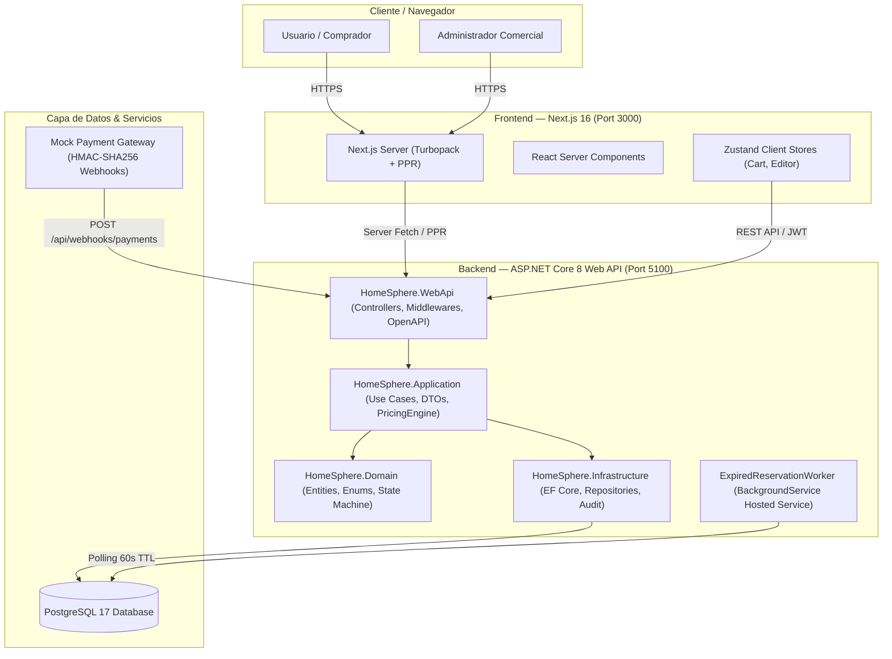
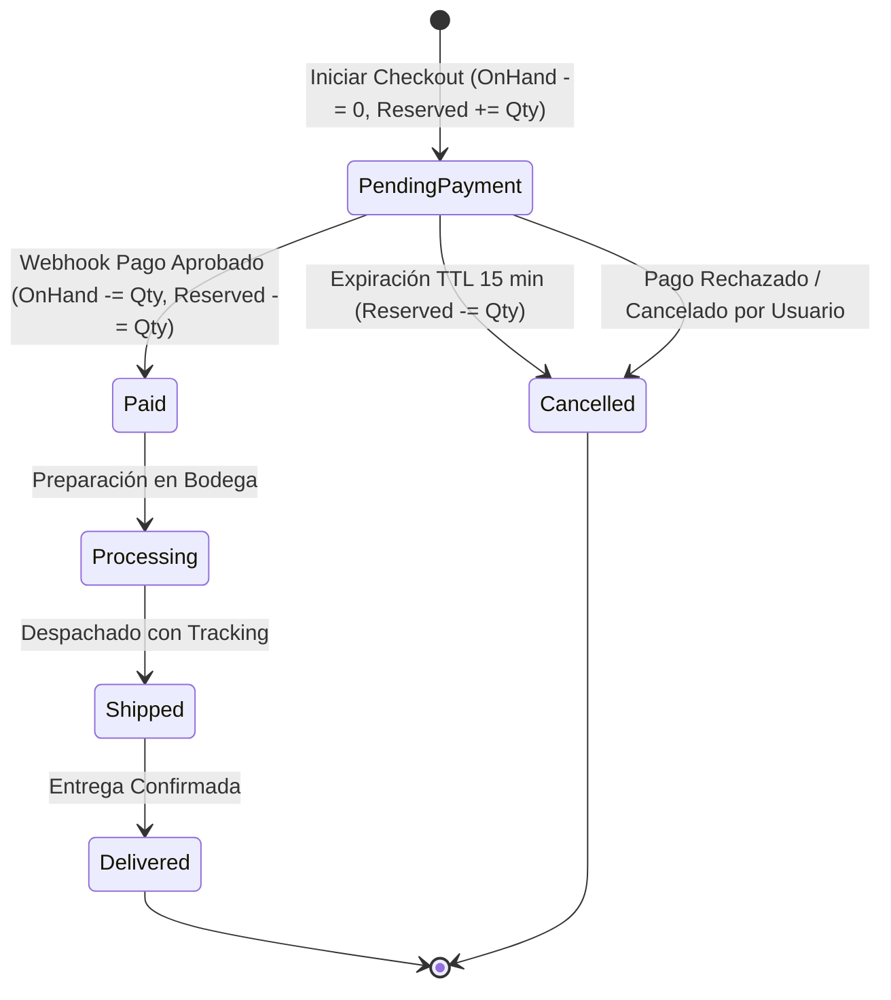
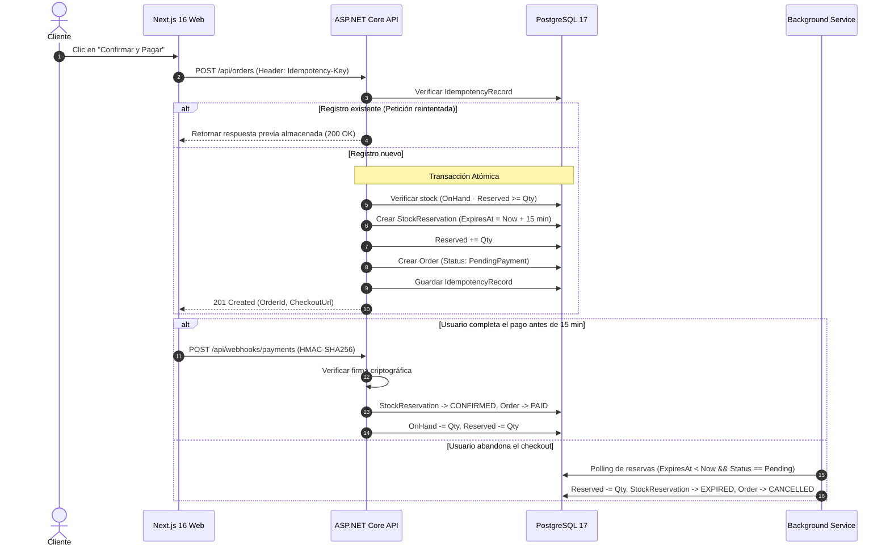

# HomeSphere 🏠🛋️
> **E-commerce Flagship de Mobiliario y Decoración con Experiencia Inmersiva de Ambientes Interactivos ("Shop the Room").**  
> *Desarrollado bajo Clean Architecture en .NET 8 (C#) y Next.js 16 (App Router + Turbopack + PPR).*

[](https://github.com/Jp3528/HomeSphere/actions/workflows/ci.yml)


---

## 📋 Índice
1. [Visión Ejecutiva y Problema de Negocio](#-visión-ejecutiva-y-problema-de-negocio)
2. [El Diferenciador Estrella: Ambientes Interactivos ("Shop the Room")](#-el-diferenciador-estrella-ambientes-interactivos-shop-the-room)
3. [Arquitectura del Sistema & Diagramas C4](#-arquitectura-del-sistema--diagramas-c4)
4. [Flujos Críticos de Dominio y Concurrencia](#-flujos-críticos-de-dominio-y-concurrencia)
5. [Decisiones de Arquitectura (ADR Summary)](#-decisiones-de-arquitectura-adr-summary)
6. [Estructura del Repositorio](#-estructura-del-repositorio)
7. [Puesta en Marcha en 1 Comando (Docker Compose)](#-puesta-en-marcha-en-1-comando-docker-compose)
8. [Cuentas Semilla & Credenciales de Prueba](#-cuentas-semilla--credenciales-de-prueba)
9. [Guion de Entrevista Técnica (6 a 8 Minutos)](#-guion-de-entrevista-técnica-6-a-8-minutos)

---

## 🎯 Visión Ejecutiva y Problema de Negocio

El comercio electrónico de hogar y mobiliario de alta gama enfrenta dos problemas fundamentales:
1. **Fricción de visualización espacial**: Los clientes abandonan carritos porque no pueden visualizar cómo combinar sofás, mesas y luminarias en un entorno real.
2. **Altas tasas de devolución**: Comprar productos aislados genera discrepancias estéticas y de escala en el hogar.

**HomeSphere** resuelve esto integrando un catálogo transaccional de alto rendimiento con **Ambientes Interactivos**:
* Los usuarios exploran habitaciones fotográficas completas con **hotspots interactivos** posicionados con precisión porcentual.
* Con la función **"Comprar Ambiente Completo"**, el usuario puede adquirir la ambientación completa en un solo clic, aumentando el Ticket Promedio (AOV).
* El equipo comercial cuenta con un **Editor Visual WYSIWYG** con modo *Live Preview* y coordenadas de clic automáticas, eliminando la dependencia de desarrolladores para lanzar campañas.

---

## 🌟 El Diferenciador Estrella: Ambientes Interactivos ("Shop the Room")

```
 ┌────────────────────────────────────────────────────────┐
 │  Living Nórdico Serena                    [Live Preview]│
 │  ┌──────────────────────────────────────────────────┐  │
 │  │                                                  │  │
 │  │       🔴 (Hotspot Mesa)                          │  │
 │  │                                                  │  │
 │  │                  🔴 (Hotspot Sofá 3 Cpos)        │  │
 │  │                                                  │  │
 │  └──────────────────────────────────────────────────┘  │
 │  Subtotal Ambiente: $1,748.00  [Comprar Ambiente Completo]│
 └────────────────────────────────────────────────────────┘
```

* **Coordenadas Porcentuales Inmunes a la Resolución**: Los pines se definen como `(x: 0-100%, y: 0-100%)`, garantizando precisión milimétrica en móviles, tablets y monitores 4K ultra-wide.
* **Degradación Elegante de Disponibilidad**: Si un producto del ambiente es archivado o su variante queda sin stock, el hotspot no rompe la interfaz: muestra una insignia `"Sin stock"` o `"No disponible"` y desactiva la compra selectiva manteniendo la estética.
* **Accesibilidad Total WCAG 2.2 AA**:
  * Touch targets garantizados $\ge 44 \times 44\text{ px}$ (`h-11 w-11`) para evitar errores táctiles en smartphones.
  * Soporte nativo de navegación por teclado (`Tab`, `Enter`, `Escape`), atributos `aria-expanded`, `aria-haspopup` y foco visible de alto contraste.
* **Editor Visual Administrativo (WYSIWYG)**:
  * Click-to-place pin sobre la imagen del ambiente.
  * Búsqueda reactiva de productos con debounce y selector de variantes.
  * Switch instantáneo entre modo Edición y Live Preview interactivo.

---

## 🏛️ Arquitectura del Sistema & Diagramas C4

HomeSphere está diseñado como un **Clean Monolith** pragmático y modular. La lógica de negocio está desacoplada de la infraestructura y del framework web.



### Capas del Backend (.NET 8):
* **`HomeSphere.Domain`**: Entidades puras (`Order`, `OrderItem`, `Product`, `ProductVariant`, `InventoryItem`, `StockReservation`, `InteractiveScene`, `SceneHotspot`, `AuditLog`), enums y reglas invariantes. Cero dependencias externas.
* **`HomeSphere.Application`**: Casos de uso, interfaces (`IOrderService`, `IInventoryService`, `IAnalyticsService`, `IAuditService`), DTOs, cálculo de precios y validaciones.
* **`HomeSphere.Infrastructure`**: EF Core 8 DbContext, configuraciones fluidas de entidades, migraciones Npgsql, auditoría con redacción recursiva de secretos y servicio mock de pagos.
* **`HomeSphere.WebApi`**: Controladores REST, middleware de Correlation ID, manejo global de excepciones (`ProblemDetails` RFC 7807), autenticación JWT y Background Services.

---

## 🔄 Flujos Críticos de Dominio y Concurrencia

### 1. Máquina de Estados de Órdenes y Reserva de Stock con TTL (15 min)



### 2. Idempotencia y Protección contra Doble Cargo



---

## 🛡️ Resiliencia, Seguridad y Observabilidad

1. **Recálculo de Totales 100% en el Servidor**:
   * El cliente envía únicamente `{ variantId, quantity }`.
   * El servidor resuelve el precio actual de la base de datos, valida cupones activos con fechas y topes, calcula impuestos y costos de envío. Ningún precio proveniente del frontend es confiable.
2. **Redacción Recursiva Automática de Secretos**:
   * El servicio de auditoría intercepta las cargas útiles JSON y reemplaza automáticamente campos sensibles (`password`, `token`, `secret`, `cardnumber`, `cvv`, `authorization`) con `[REDACTED]` antes de persistir en la tabla `AuditLogs`.
   * Serialización UTF-8 relajada para evitar escapar caracteres en español (e.g. `Actualización` se almacena fielmente sin `\u00F3`).
3. **Métricas de Ingreso Reconocido**:
   * El dashboard de analíticas calcula ingresos únicamente sobre órdenes pagadas (`Paid`, `Processing`, `Shipped`, `Delivered`), aislando las reservas abandonadas (`PendingPayment`) y canceladas (`Cancelled`) para no falsear el EBITDA.

---

## ⚖️ Decisiones de Arquitectura (ADR Summary)

| Código | Decisión | Alternativa Evaluada | Justificación Técnica |
|---|---|---|---|
| **ADR-001** | **Monolito Modular (.NET 8)** | Microservicios distribuidos | Elimina latencia de red en checkout, previene inconsistencias transaccionales distribuidas (Saga/2PC) y simplifica el despliegue con alta cohesión. |
| **ADR-002** | **Next.js 16 con PPR y Turbopack** | SPA tradicional (Vite) | Permite renderizado estático instantáneo de shells de página (SEO y LCP < 1.2s) con streaming dinámico de carritos y disponibilidad en tiempo real. |
| **ADR-003** | **Reserva de Stock con TTL de 15 min** | Bloqueo al añadir al carrito | Evita ataques de denegación de inventario donde usuarios acaparan stock añadiendo productos al carrito sin intención real de compra. |
| **ADR-004** | **Coordenadas Porcentuales (0-100%)** | Coordenadas fijas en píxeles | Soporte omnicanal independiente de resolución y ratio de aspecto; se adapta automáticamente a layouts responsive fluidos. |
| **ADR-005** | **Idempotencia persistida en PostgreSQL** | Cache temporal en Redis | Garantiza consistencia ACID junto con la creación de la orden dentro de la misma transacción relacional, sin riesgo de pérdida de claves por evicción. |

---

## 📁 Estructura del Repositorio

```text
homesphere/
├── .github/
│   └── workflows/
│       └── ci.yml                      # CI Pipeline: Tests .NET 8 + Build Next.js 16
├── apps/
│   ├── api/                            # Backend .NET 8 (Clean Architecture)
│   │   ├── Dockerfile                  # Multi-stage hardened build (non-root app user)
│   │   ├── HomeSphere.sln
│   │   ├── src/
│   │   │   ├── HomeSphere.Domain/      # Entidades de dominio, enums y value objects
│   │   │   ├── HomeSphere.Application/ # Casos de uso, interfaces, DTOs y reglas
│   │   │   ├── HomeSphere.Infrastructure/ # EF Core 8, PostgreSQL, Seeder, AuditService
│   │   │   └── HomeSphere.WebApi/      # Controllers, Middlewares, BackgroundWorkers
│   │   └── tests/
│   │       ├── HomeSphere.UnitTests/   # 72 pruebas unitarias automatizadas
│   │       └── HomeSphere.IntegrationTests/ # 7 pruebas de integración (WebApplicationFactory)
│   └── web/                            # Frontend Next.js 16 (App Router + Turbopack)
│       ├── Dockerfile                  # Multi-stage standalone build (non-root nextjs)
│       ├── package.json
│       ├── next.config.ts              # Standalone output, PPR enabled, Turbo rules
│       └── src/
│           ├── app/                    # Rutas públicas, checkout, catálogo, wishlist y admin
│           ├── components/             # SceneViewer, HotspotPin, WysiwygEditor, Dashboard
│           ├── lib/                    # API clients, auth token store, formatters
│           └── stores/                 # Zustand stores (useCartStore, useWishlistStore)
├── docs/                               # Documentación técnica modular
│   ├── interactive-scenes.md           # Especificación de escenas y editor WYSIWYG
│   └── analytics-and-audit.md          # Especificación de KPIs y redactor de auditoría
├── docker-compose.yml                  # Orquestación de producción local en 1 comando
├── CHANGELOG.md                        # Historial de cambios y releases (v1.0.0)
└── README.md                           # Documento principal
```

---

## ⚡ Puesta en Marcha en 1 Comando (Docker Compose)

El proyecto está completamente preparado para levantarse con Docker y Docker Compose sin requerir instalación previa de herramientas de compilación en el host:

```bash
# Clonar el repositorio
git clone https://github.com/Jp3528/HomeSphere.git
cd HomeSphere

# Levantar toda la plataforma (PostgreSQL 17 + .NET 8 API + Next.js 16)
docker compose up --build
```

### URLs de la Plataforma:
* **Frontend Web**: [http://localhost:3000](http://localhost:3000)
* **API REST & Swagger UI**: [http://localhost:5100/swagger](http://localhost:5100/swagger)
* **API Health Check**: [http://localhost:5100/health/status](http://localhost:5100/health/status)

---

## 👤 Cuentas Semilla & Credenciales de Prueba

La base de datos se inicializa automáticamente con datos de demostración realistas al arrancar en entorno de desarrollo:

| Rol | Correo Electrónico | Contraseña | Permisos |
|---|---|---|---|
| **Administrador** | `admin@homesphere.com` | `Admin123!` | Acceso completo a `/admin`, Dashboard Comercial, Editor WYSIWYG y Logs de Auditoría |
| **Cliente Regular** | `cliente@homesphere.com` | `Cliente123!` | Exploración de catálogo, ambientes, carrito, checkout protegido e historial en `/account/orders` |

### Pasarela de Pagos de Prueba (Mock Gateway):
* **Firma de Webhook Secret**: `whsec_mock_super_secret_key_for_testing_123456`
* Simula transacciones inmediatas o asíncronas con reintentos para validar la idempotencia.

---

## 🎙️ Guion de Entrevista Técnica (6 a 8 Minutos)

Estructura diseñada para presentar HomeSphere ante un **Tech Lead**, **Engineering Manager** o **Staff Engineer**, destacando el criterio de diseño, la resiliencia y el valor de negocio.

---

### Minuto 0:00 - 1:00 | El Gancho & El Propósito de Negocio
> *"Hola, les presento **HomeSphere**. Diseñé esta plataforma para resolver uno de los mayores cuellos de botella en el e-commerce de hogar y mobiliario: la dificultad que tienen los usuarios para visualizar cómo lucen varios productos en un espacio real, lo cual suele inflar las tasas de abandono de carrito y devoluciones.  
> A diferencia de una tienda convencional de listados planos, en HomeSphere construí una experiencia inmersiva llamada **'Shop the Room'**: los clientes exploran habitaciones fotográficas con hotspots interactivos accesibles y pueden comprar el ambiente completo en un solo clic.  
> A nivel de ingeniería, no es una maqueta: es un **Clean Monolith** en .NET 8 con PostgreSQL 17 y Next.js 16, diseñado con tolerancia a alta concurrencia, reservas atómicas de stock, idempotencia y redacción de secretos."*

---

### Minuto 1:00 - 3:00 | Arquitectura Backend, Concurrencia e Inventario
> *"En el backend utilicé **Clean Architecture** estructurada en 4 capas estrictas: Dominio, Aplicación, Infraestructura y Web API.  
> Uno de los mayores desafíos en e-commerce durante eventos de alto tráfico como CyberDays es la sobresaturación y el sobregiro de stock (*overselling*).  
> Para resolverlo, implementé una máquina de estados con **separación de inventario OnHand y Reserved**:  
> Cuando el cliente inicia el checkout, la API no le resta stock al almacén físico directamente, sino que crea una `StockReservation` atómica con un TTL de 15 minutos en PostgreSQL. Si el cliente abandona la compra o falla la pasarela de pagos, un **BackgroundService** (`ExpiredReservationWorker`) detecta periódicamente las reservas caducadas y libera el inventario automáticamente.  
> Además, protegí las órdenes con un middleware y encabezado `Idempotency-Key`: si un usuario hace doble clic por mala conexión o el webhook de pagos envía reintentos, el sistema garantiza que no ocurra un cobro duplicado ni se descuente el inventario dos veces."*

---

### Minuto 3:00 - 5:00 | Frontend de Alto Rendimiento, Ambientes Interactivos & Accesibilidad
> *"Para el frontend elegí **Next.js 16 con App Router, Turbopack y Partial Prerendering (PPR)**.  
> Las páginas de catálogo y ambientes tienen un *shell* estático ultrarrápido renderizado en el servidor para maximizar el SEO y lograr un First Contentful Paint de menos de un segundo, mientras que el carrito, la autenticación y el editor cargan de forma dinámica y reactiva mediante **Zustand**.  
> En los ambientes interactivos, resolví el desafío del soporte multidispositivo mapeando las coordenadas de los pines en **porcentajes normalizados (0 a 100%)** respecto al contenedor de la imagen, en lugar de píxeles absolutos. Esto asegura que el pin apunte con exactitud milimétrica al sofá o a la lámpara sin importar si se ve en un iPhone o en un monitor 4K.  
> Prioricé la **accesibilidad (WCAG 2.2 AA)**: cada botón táctil cumple el área mínima recomendada de $44 \times 44\text{ px}$, tiene soporte de navegación completa por teclado con tabulaciones lógicas, `aria-expanded` y gestión de foco al abrir el modal emergente.  
> Y para el equipo comercial, construí un **Editor WYSIWYG** que les permite hacer clic sobre la imagen, buscar un producto con debounce y publicar ambientes sin requerir soporte técnico."*

---

### Minuto 5:00 - 7:00 | Resiliencia en Pagos, Auditoría y Dashboard Ejecutivo
> *"En la integración financiera, simulé el ciclo completo de webhooks de pasarelas como Stripe o MercadoPago utilizando validación de firma criptográfica **HMAC-SHA256**. Solo se reconoce la orden como pagada si la firma del payload coincide con el secreto del servidor.  
> En la capa de observabilidad, implementé un servicio de **auditoría operacional** con redacción recursiva de secretos: cualquier petición que contenga contraseñas, tokens o números de tarjeta se sanitiza automáticamente antes de guardarse en la base de datos, cumpliendo principios de protección de datos sensibles.  
> Asimismo, el panel de administración cuenta con un **Dashboard Comercial** que calcula métricas reales de negocio: Ingreso Reconocido (separando estrictamente órdenes pagadas de las pendientes o canceladas), Ticket Promedio (AOV), gráficos de tendencia diaria a 30 días y alertas tempranas para productos con stock bajo ($\le 5$ unidades)."*

---

### Minuto 7:00 - 8:00 | Trade-offs, Pruebas y Próximos Pasos
> *"En cuanto a decisiones de diseño y trade-offs:  
> Elegí un **Clean Monolith** en lugar de microservicios distribuidos porque para el tamaño y etapa del negocio, la complejidad operacional de orquestar múltiples servicios con transacciones distribuidas (Saga) habría agregado fricción innecesaria. El monolito modular nos da transacciones ACID locales y un despliegue muy simple.  
> La solución cuenta con **79 pruebas automatizadas** (72 pruebas unitarias y 7 pruebas de integración con `WebApplicationFactory`) que cubren la lógica de cálculo de precios, reservas de stock, movimientos de almacén, lista de deseos y redacción de secretos, acompañadas de un pipeline de **CI en GitHub Actions** y configuración de **Docker Multi-stage** con imágenes optimizadas y seguras bajo usuarios no root.  
> Si tuviéramos que escalar esto a millones de usuarios concurrentes, el siguiente paso evolutivo sería incorporar Redis para las reservas distribuidas de alta frecuencia y OpenTelemetry para trazas distribuidas.  
> Quedo a su disposición para profundizar en cualquier línea de código o componente arquitectónico."*

---

## 📄 Licencia
Este proyecto fue creado como portafolio de ingeniería de software de alto impacto bajo la licencia [MIT](LICENSE).
