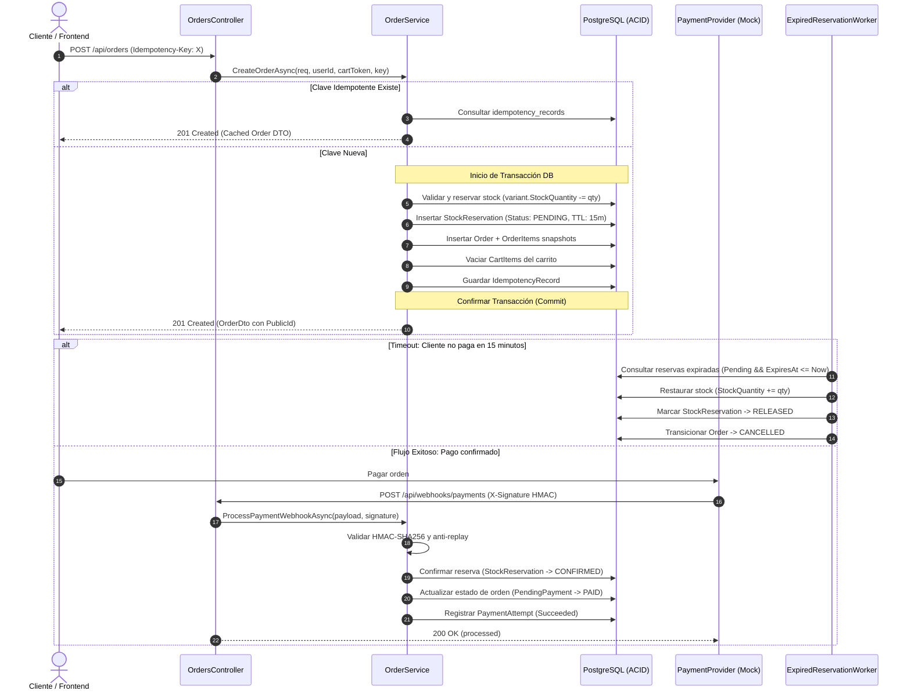
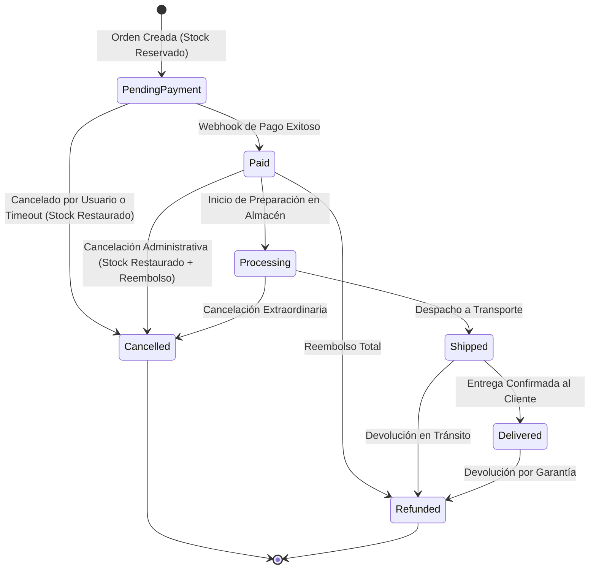

# Arquitectura Transaccional de Pedidos, Reservas de Stock y Pasarela de Pagos (Semana 5)

## 1. Visión General y Principios de Diseño

El módulo de pedidos y pagos de **HomeSphere** implementa el núcleo transaccional y comercial de la plataforma, asegurando las siguientes garantías de nivel empresarial:

1. **Autoridad 100% en Servidor**: El cliente jamás dicta precios, descuentos, costos de envío ni el estado de pago de una orden.
2. **Prevención Estricta de Overselling**: Bloqueo y reserva atómica de inventario durante el checkout, impidiendo la venta de unidades inexistentes bajo concurrencia.
3. **Idempotencia de Extremo a Extremo**: Protección contra doble clic o reintentos de red mediante el encabezado `Idempotency-Key` en `POST /api/orders` y control de transacciones en webhooks de pago.
4. **Inmutabilidad Histórica**: Todos los datos del producto (precio unitario, nombre, SKU, atributos JSON y fotografía) se congelan en snapshots dentro de `order_items`. Modificaciones posteriores en el catálogo no alteran los pedidos ya creados.
5. **Seguridad Criptográfica en Webhooks**: Los callbacks de pago requieren validación de firma digital HMAC-SHA256 con comparación en tiempo constante (`CryptographicOperations.FixedTimeEquals`), impidiendo ataques de falsificación y replay.

---

## 2. Flujo Transaccional y Ciclo de Vida del Pedido

---

## 3. Modelo de Entidades de Base de Datos

| Entidad | Tabla en BD | Responsabilidad |
|---|---|---|
| `Order` | `orders` | Registro maestro del pedido con `OrderNumber` (`HS-YYYYMM-XXXX`), `PublicId` seguro para URLs, totales, cupones y snapshots de dirección. |
| `OrderItem` | `order_items` | Snapshot inmutable de cada variante comprada (`SkuSnapshot`, `ProductNameSnapshot`, `UnitPrice`, `Quantity`, `TotalPrice`). |
| `StockReservation` | `stock_reservations` | Reserva temporal de stock (`Pending`, `Confirmed`, `Released`, `Expired`) con TTL de 15 minutos. |
| `OrderStatusHistory` | `order_status_history` | Trazabilidad y auditoría de transiciones de estado con autor (`Customer`, `Admin`, `PaymentWebhook`, `SystemCleanupWorker`) y motivo. |
| `PaymentAttempt` | `payment_attempts` | Registro histórico de intentos y transacciones de pago (`Initiated`, `Succeeded`, `Failed`), identificador de pasarela y payload en crudo. |
| `IdempotencyRecord` | `idempotency_records` | Almacenamiento seguro de respuestas cacheadas por clave y hash SHA-256 de la petición con TTL de 24 horas. |

---

## 4. Máquina de Estados del Pedido

El ciclo de vida del pedido se controla mediante transiciones estrictas. Las transiciones no autorizadas son rechazadas con `BusinessRuleValidationException` (HTTP 400 ProblemDetails):

---

## 5. Pruebas Unitarias y Matriz de Verificación (47/47 Tests)

La suite de pruebas en `HomeSphere.UnitTests/Orders/OrderServiceTests.cs` valida exhaustivamente:

1. **Creación con Stock Válido**: Deduce inventario en base de datos, crea snapshots inmutables y genera reserva con estado `Pending`.
2. **Resistencia a Overselling**: Si el inventario disponible es inferior a la cantidad solicitada, lanza `BusinessRuleValidationException`, no crea pedidos parciales ni modifica el inventario.
3. **Idempotencia con Misma Clave**: Reintentos idénticos devuelven la orden previamente creada sin duplicar deducciones de stock.
4. **Protección Anti-IDOR en Checkout**: Un usuario autenticado no puede asignar la dirección de otro usuario en su pedido (lanza `ForbiddenAccessException`).
5. **Motor de Cupones en Pedido**: Aplica correctamente descuentos porcentuales con tope y descuentos fijos, incrementando `TimesUsed` transaccionalmente.
6. **Webhook Criptográfico Válido**: Pasa el pedido a `Paid`, confirma las reservas y almacena el intento en `payment_attempts`.
7. **Rechazo de Firmas Inválidas**: Rechaza payloads alterados o firmas HMAC incorrectas.
8. **Idempotencia del Webhook**: Webhooks repetidos para la misma transacción no repiten transiciones ni causan inconsistencias.
9. **Transiciones Inválidas**: Pasar directamente de `PendingPayment` a `Shipped` es bloqueado por la máquina de estados.
10. **Cancelación y Liberación de Stock**: Cancelar una orden pendiente restaura el stock exactamente una vez y libera las reservas.
11. **Limpieza Automática de Reservas Expiradas**: Cancela órdenes con reservas vencidas (>15 min) y reincorpora el stock al catálogo.
